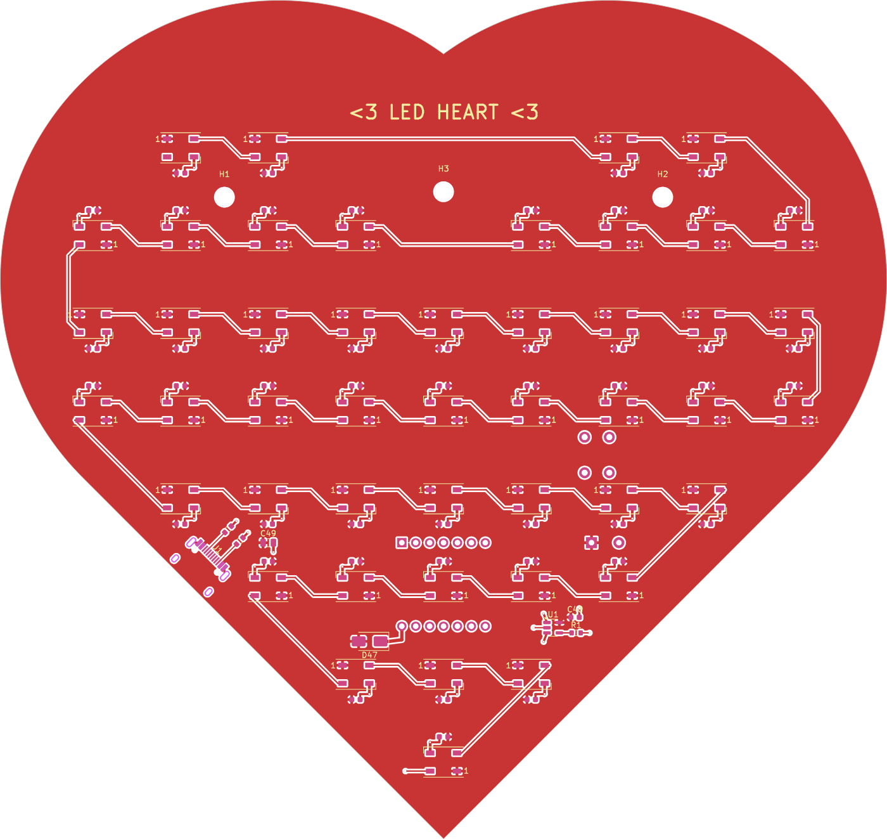
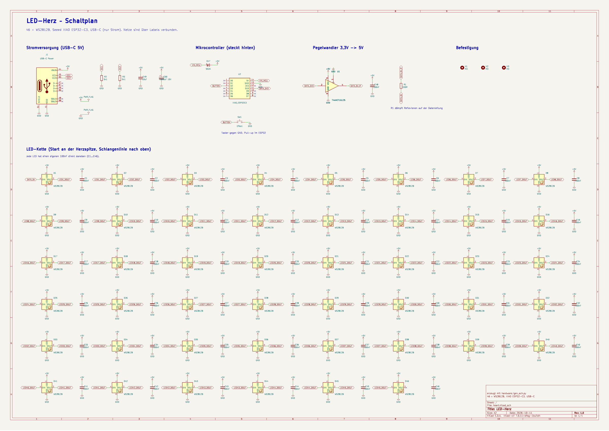

# Journal – LED-Herz

Bau-Tagebuch für das Projekt. Pro Arbeitssitzung ein Eintrag: was gemacht, was gelernt, was schiefging,
wie lange. Bilder/Screenshots am besten nach `docs/` legen und hier verlinken.

**Gesamtzeit bisher:** _bitte eintragen_

---

## 2026-10-11 – Idee, Planung, Platine und Firmware

**Zeit:** _bitte eintragen_

### Die Idee
Ich will ein Herz aus LEDs bauen, das Lichtshows abspielt. Nicht auf Pappe gebastelt, sondern
als **eigene Platine**, weil ich endlich mal ein eigenes PCB designen will.

### Entscheidungen
- **ESP32** als Controller, weil er schnell, billig und per USB programmierbar ist.
  Genommen hab ich den **Seeed XIAO ESP32-C3**: winzig, USB-C drauf, und die Pinabstände sind genau bekannt.
  Er steckt auf Buchsenleisten hinten auf der Platine, man kann ihn also wieder abziehen.
- **WS2812B-LEDs**, weil jede LED einzeln jede Farbe kann. Nur damit gehen echte Lichtshows.
- **46 LEDs** in einer 9 × 8 Herz-Matrix mit 16 mm Abstand. Das Herz wird damit ca. 16 × 15 cm groß.
- **JLCPCB bestückt** die SMD-Teile (46 LEDs + 47 Kondensatoren von Hand löten wäre hart).
  Selbst löten muss ich nur Buchsenleisten, Taster und Elko.
- **Ein Taster** schaltet die Effekte um, lang drücken ändert die Helligkeit.
- **Strom über USB-C**, extra Buchse nur für Strom (5 V / 3 A), nicht über den XIAO.

### Was ich gelernt habe
- Der ESP32 gibt **3,3 V** aus, WS2812B bei 5 V wollen eigentlich mindestens 3,5 V als „High“.
  Deshalb sitzt ein **Pegelwandler 74AHCT1G125** dazwischen.
- Jede WS2812B braucht einen **100 nF Kondensator** direkt daneben, sonst flackert's.
- **Kupferflächen statt dicker Leiterbahnen:** Vorderseite komplett +5V, Rückseite komplett GND.
  So bekommen alle LEDs genug Strom und das Routing ist einfach.
- Bei **USB-C** muss man zwei **5,1 kΩ** an CC1/CC2 nach GND setzen, sonst liefert ein USB-C-Netzteil gar keinen Strom.
- Eine **Schottky-Diode** vor dem 5V-Pin des XIAO verhindert, dass der Laptop beim Flashen
  über den XIAO alle LEDs versorgen muss.
- **DRC (Design Rule Check)** findet Fehler, die man mit bloßem Auge nie sieht.

### Was schiefging (und wie es gelöst wurde)
1. **Herzform v1** war die bekannte Mathe-Herzkurve. Problem: oben eine super tiefe Kerbe
   und unten eine zu schmale Spitze, da liefen Leiterbahnen über den Rand.
   → **Herzform v2:** zwei Kreisbögen + gerade 45°-Flanken zur Spitze. Die unteren LED-Reihen bilden
   sowieso eine 45°-Treppe, das passt perfekt.
2. Die Zeilenwechsel der LED-Kette liefen erst außen um die Reihen herum und damit über den Rand.
   → Jetzt laufen sie **schräg auf der Treppe** von einer Reihe zur nächsten.
3. Eine schräge Leitung ging nur **0,16 mm** an einem Pad vorbei (erlaubt sind 0,2 mm).
   → Leitung genau mittig zwischen die Pads geschoben.
4. Die USB-C-Buchse war erst links an einer extra Geraden im Umriss. Sah komisch aus (Stufe im Herz).
   → Jetzt sitzt sie **schräg auf der unteren linken Flanke**, das Kabel hängt nach unten raus.
5. Der **1000-µF-Elko** stand direkt vor der USB-Buchse des XIAO. Man hätte kein Kabel einstecken können!
   → Auf die andere Seite verschoben. Gefunden habe ich das nur, weil ich mir die Rückseite als Bild angeschaut habe.

### Ergebnis
- Platine fertig: **DRC 0 Fehler, 0 offene Verbindungen**
- Bestelldateien für JLCPCB in `hardware/production/` (Gerber, BOM, CPL), alle LCSC-Nummern geprüft
- Firmware mit 7 Effekten + Auto-Modus kompiliert
- Test bestätigt, dass Firmware und Platine dieselbe LED-Reihenfolge haben
- Browser-Vorschau `tools/preview.html`, um die Effekte ohne Hardware zu sehen



### Nächste Schritte
- [ ] Platine in KiCad selbst anschauen (3D-Ansicht: Ansicht → 3D-Viewer)
- [x] Schaltplan in KiCad
- [ ] Bei JLCPCB hochladen, **Bauteil-Drehung in der Vorschau prüfen**, bestellen
- [ ] XIAO ESP32-C3, Buchsenleisten, Taster, Elko besorgen
- [ ] Löten, flashen, testen
- [ ] Video von der Lichtshow machen

---

## 2026-10-11 (später) – Echter KiCad-Schaltplan

**Zeit:** _bitte eintragen_

### Was ich gemacht habe
- Richtigen **KiCad-Schaltplan** `hardware/heart.kicad_sch` gebaut, mit den Original-Symbolen aus KiCad
  (WS2812B, 74AHCT1G125, USB-C 16P, …) und einem eigenen Symbol für den XIAO.
- Alles ist über **Netzlabels** verbunden, die genauso heißen wie die Leitungen auf der Platine.
- Schaltplan und Platine sind **verknüpft** (jedes Bauteil hat dieselbe ID in beiden Dateien),
  dadurch funktioniert in KiCad „Leiterplatte aus Schaltplan aktualisieren“.
- `check_sch.py` lässt KiCad die Netzliste exportieren und vergleicht **jeden Pin** mit der Platine:
  106 Bauteile, 54 Netze, 328 Pins, alles gleich.
- PDF zum Anschauen: `docs/schematic.pdf`

### Probleme / Lösungen
- KiCad wollte die erste Version nicht öffnen. Grund: Mein Skript hat in der Datei die Reihenfolge
  von Einträgen vertauscht (`hide` vor `font`). Reihenfolge beibehalten, dann ging's.
- Einige GND-/+5V-Symbole standen auf Nachbarpins → längere Leitungsstücke davor.



---

## Vorlage für neue Einträge

```
## JJJJ-MM-TT – Titel

**Zeit:** x h

### Was ich gemacht habe

### Probleme / Lösungen

### Bilder

### Nächste Schritte
```
