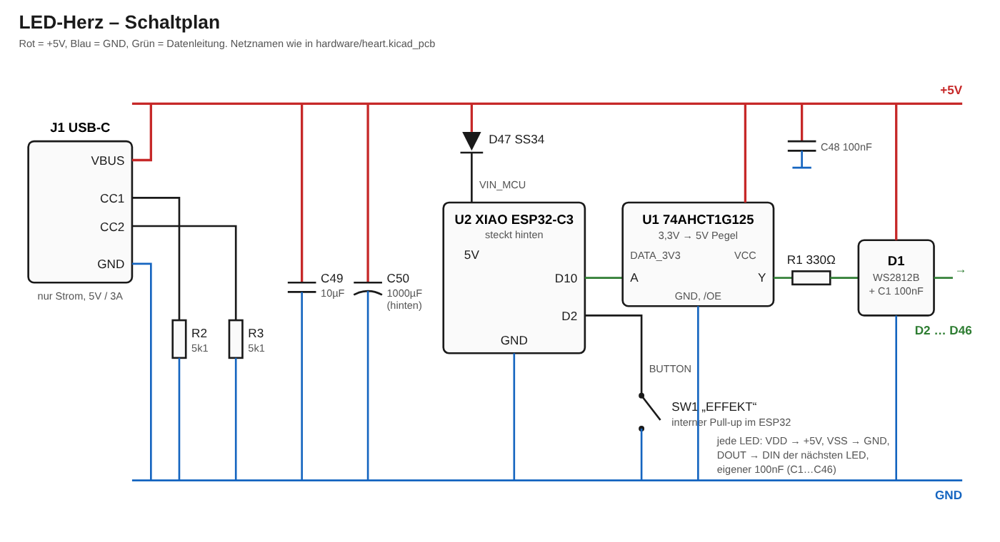
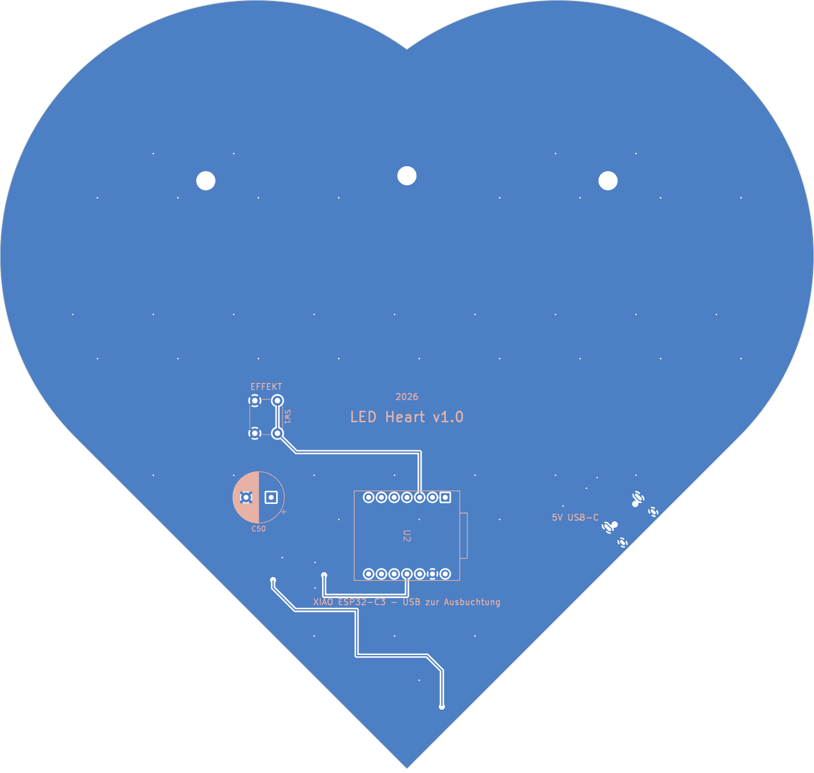
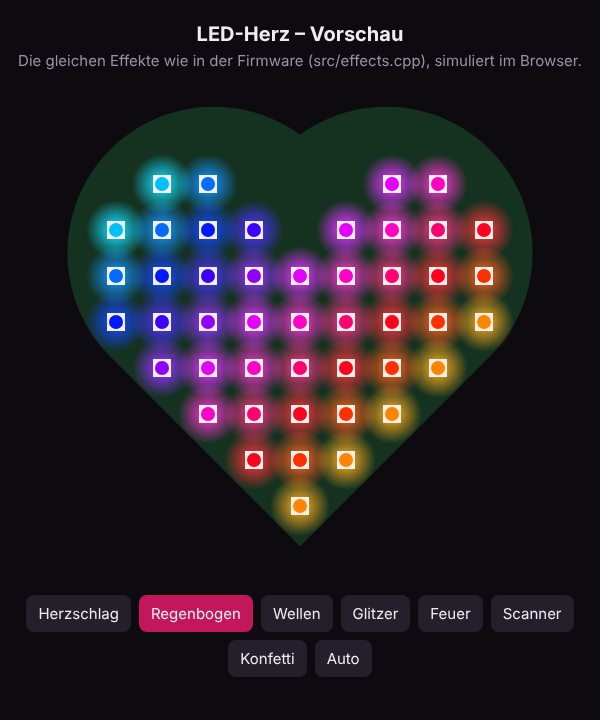
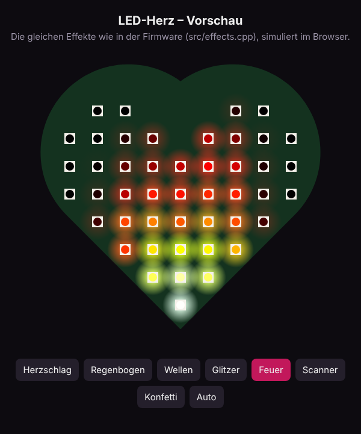

# <3 LED-Herz

Ein herzförmiges PCB mit **46 RGB-LEDs (WS2812B)**, das eine Lichtshow abspielt.
Ein Taster auf der Rückseite schaltet zwischen den Effekten um, Strom kommt per **USB-C**.
Gesteuert wird alles von einem **Seeed XIAO ESP32-C3**, der hinten aufgesteckt ist.


| | |
|---|---|
| Größe | ca. 162 × 153 mm, 2 Lagen, 1,6 mm |
| LEDs | 46 × WS2812B-5050, Raster 16 mm, je ein 100 nF Kondensator |
| Controller | Seeed XIAO ESP32-C3 (oder XIAO ESP32-S3, gleiche Pinbelegung) |
| Strom | USB-C 5 V (nur Strom), Software-Limit 1,5 A |
| Bedienung | 1 Taster: kurz = nächster Effekt, lang = Helligkeit |
| Effekte | Herzschlag, Regenbogen, Wellen, Glitzer, Feuer, Scanner, Konfetti, Auto |

## So funktioniert's



- **USB-C (J1)** liefert 5 V. Die zwei 5,1 kΩ an CC1/CC2 sagen dem Netzteil: „Ich will 5 V“.
- **+5V** liegt als Kupferfläche auf der ganzen Vorderseite, **GND** als Fläche auf der ganzen Rückseite.
  Dadurch kommen alle LEDs ohne dicke Leiterbahnen an genug Strom.
- Der **XIAO** bekommt seine 5 V über die Schottky-Diode **D47**. Dadurch kannst du den XIAO
  gleichzeitig am PC (zum Flashen) und am Netzteil haben, ohne dass der PC die LEDs versorgen muss.
- Der ESP32 gibt 3,3 V-Signale aus, die WS2812B wollen bei 5 V eigentlich ≥ 3,5 V sehen.
  Der **74AHCT1G125 (U1)** hebt das Datensignal sauber auf 5 V, **R1 (330 Ω)** dämpft die Leitung.
- Die LEDs hängen als **Kette** hintereinander: Start unten an der Spitze, dann in Schlangenlinien nach oben.
  Die Firmware kennt diese Reihenfolge (`src/heart_map.h`), damit Effekte wie „Feuer“ wirklich von unten nach oben laufen.

| Vorderseite (LEDs, +5V-Fläche) | Rückseite (GND-Fläche, XIAO, Taster, Elko) |
|---|---|
|  |  |

## Ordner

```
hardware/
  gen_pcb.py          erzeugt die komplette Platine per Skript (KiCad 7+)
  drc.py              Design-Rule-Check (prüft Abstände, Verbindungen)
  export.py           Gerber + BOM + CPL für JLCPCB
  heart.kicad_pcb     die Platine (mit KiCad öffnen)
  heart.pretty/       eigener Footprint für den XIAO-Sockel
  production/         fertige Bestelldateien (heart_gerber.zip, heart_bom.csv, heart_cpl.csv)
src/                  Firmware (PlatformIO / Arduino)
test/test_chain.cpp   prüft, dass Firmware und Platine dieselbe LED-Reihenfolge haben
tools/preview.html    Lichtshow im Browser ansehen, ganz ohne Hardware
docs/                 Bilder und Schaltplan
JOURNAL.md            Bau-Tagebuch
```

## 1. Platine bei JLCPCB bestellen

1. Auf [jlcpcb.com](https://jlcpcb.com) → **Order now** → `hardware/production/heart_gerber.zip` hochladen.
2. Einstellungen: **2 Layers**, Dicke **1.6 mm**, Farbe nach Wahl (Rot oder Schwarz sieht beim Herz gut aus),
   Surface Finish **HASL (lead free)** reicht.
3. Unten **PCB Assembly** einschalten → **Assemble top side**, Stückzahl z. B. 2 (Minimum bei Bestückung).
4. **BOM** = `hardware/production/heart_bom.csv`, **CPL** = `hardware/production/heart_cpl.csv` hochladen.
5. Im Bauteil-Check sollten alle 8 Positionen gefunden werden (LCSC-Nummern sind drin, geprüft im Oktober 2026):

   | Teil | Menge | LCSC |
   |---|---|---|
   | WS2812B-B/W (5050) | 46 | C114586 |
   | 100 nF 0603 | 47 | C14663 |
   | 10 µF 0805 | 1 | C15850 |
   | 5,1 kΩ 0603 | 2 | C23186 |
   | 330 Ω 0603 | 1 | C23138 |
   | SN74AHCT1G125DBVR | 1 | C7484 |
   | SS34 (SMA) | 1 | C408258 |
   | USB-C HRO TYPE-C-31-M-12 | 1 | C165948 |

6. **Ganz wichtig: Bestückungs-Vorschau anschauen!** JLCPCB zeigt die Bauteile über der Platine an.
   Bei manchen Bauteilen (oft LEDs, SOT-23, USB-C) dreht JLCPCB anders als KiCad.
   Prüfe vor allem:
   - **LEDs:** die abgeschrägte Ecke / Markierung muss bei **Pin 1** sein (im KiCad-Footprint die „1“ im Aufdruck).
   - **U1:** Pin 1 ist der Pin links oben, wenn die 2-Pin-Seite rechts ist.
   - **D47:** der Strich (Kathode) zeigt zum XIAO hin.
   Falsch gedrehte Teile kannst du direkt in der Vorschau drehen.
7. Preis: Die Platine ist größer als 10 × 10 cm und einige Bauteile sind „Extended Parts“
   (Bestückungsgebühr pro Bauteilsorte). Schau dir das Angebot genau an, bevor du bestellst.

### Was du selbst lötest (alles Durchsteck-Teile, auf der Rückseite)

| Teil | Wo | Hinweis |
|---|---|---|
| Seeed XIAO ESP32-C3 | U2 | mit 2 × 7-poligen Stiftleisten am XIAO |
| 2 × Buchsenleiste 1×7, 2,54 mm | U2 | auf die Platine löten, XIAO steckt drauf. **Bauteile des XIAO zeigen von der Platine weg, seine USB-C-Buchse zur Ausbuchtung im aufgedruckten Rahmen** |
| Taster 6 × 6 mm (THT) | SW1 „EFFEKT“ | |
| Elko 1000 µF / 10 V, Ø 10 mm, Raster 5 mm | C50 | **Polung!** Das eckige Pad ist Plus |

Tipp: Erst Buchsenleisten, dann Taster, zuletzt den Elko löten.

## 2. Firmware flashen

Mit [PlatformIO](https://platformio.org) (VS Code-Erweiterung oder `pip install platformio`):

```bash
pio run -e xiao_esp32c3 -t upload    # flashen
pio device monitor                   # Ausgabe ansehen (115200 Baud)
```

Falls der Upload nicht klappt: am XIAO **BOOT** gedrückt halten, **RESET** kurz drücken, BOOT loslassen, nochmal hochladen.

Mit der **Arduino IDE** geht es auch: Board „XIAO_ESP32C3“ auswählen, Bibliothek **FastLED** installieren,
alle Dateien aus `src/` in einen Sketch-Ordner `heart/` kopieren und `main.cpp` in `heart.ino` umbenennen.

Beim Einschalten läuft einmal ein Regenbogen durch alle 46 LEDs in Ketten-Reihenfolge.
Bleibt er an einer Stelle hängen, hat die LED davor oder genau diese ein Lötproblem.

## 3. Bedienung

- **Kurz drücken:** nächster Effekt. Nach „Konfetti“ kommt **Auto** (wechselt alle 15 s).
- **Lang drücken (0,8 s):** Helligkeit 24 → 64 → 128 → 200.
- Effekt und Helligkeit bleiben gespeichert, auch nach dem Ausstecken.

Einstellungen (Pins, Stromlimit, Helligkeitsstufen, Auto-Zeit) stehen in `src/config.h`.
Neue Effekte schreibst du in `src/effects.cpp` und trägst sie unten in `LIST` ein.

## 4. Effekte ohne Hardware ansehen

`tools/preview.html` im Browser öffnen. Die Vorschau benutzt dieselbe LED-Anordnung und dieselben Effekte.

| Regenbogen | Feuer |
|---|---|
|  |  |

## 5. Platine selbst ändern

Die Platine wird komplett von `hardware/gen_pcb.py` erzeugt (Herzform, Bauteile, Leiterbahnen, Kupferflächen).
Du brauchst KiCad 7 oder neuer (mit Python).

```bash
python3 hardware/gen_pcb.py     # Platine neu erzeugen
python3 hardware/drc.py         # prüfen: muss "0 unconnected pads" und keine Fehler zeigen
python3 hardware/export.py      # Bestelldateien neu bauen
g++ -std=c++11 -Isrc test/test_chain.cpp -o /tmp/t && /tmp/t   # Firmware passt zur Platine?
```

Du kannst `heart.kicad_pcb` natürlich auch direkt in KiCad öffnen und von Hand weiterbearbeiten.
Dann aber `gen_pcb.py` nicht mehr laufen lassen, sonst wird deine Änderung überschrieben.

Aktueller DRC-Stand: 0 Fehler, 0 offene Verbindungen. Es bleibt eine gewollte Warnung:
Beim USB-C-Footprint wurde der Bestückungsdruck entfernt, weil er über den Platinenrand ragen würde.

## Tipps und Fehlersuche

- **Strom:** Volle Helligkeit in Weiß zieht fast 3 A. Das Software-Limit steht auf 1,5 A.
  Mit einem guten 5 V/3 A-Netzteil kannst du `POWER_MILLIAMPS` in `src/config.h` auf 2500 erhöhen.
- **Nur die ersten LEDs gehen:** Lötstelle an der ersten dunklen LED oder an der davor prüfen.
- **Farben vertauscht (Rot ↔ Grün):** in `src/config.h` `COLOR_ORDER` auf `RGB` ändern.
- **Gar nichts leuchtet:** Steckt der XIAO richtig herum? Ist das Netzteil eingesteckt
  (über den XIAO-USB allein bekommen die LEDs keinen Strom, das ist Absicht)?
- **Flackern:** Elko C50 richtig herum eingelötet?

## Lizenz

MIT, siehe [LICENSE](LICENSE).
